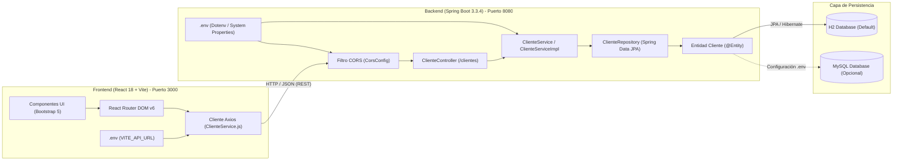

# Sistema de Gestión de Clientes (Full Stack)


Sistema web integral para la administración y gestión de clientes (operaciones CRUD completas). Desarrollado bajo una arquitectura desacoplada cliente-servidor: backend robusto con **Spring Boot** y frontend reactivo de página única (SPA) con **React** y **Vite**.

---

## 📑 Tabla de Contenidos

1. [Descripción General](#-descripción-general)
2. [Arquitectura del Sistema](#-arquitectura-del-sistema)
3. [Variables de Entorno (.env)](#-variables-de-entorno-env)
4. [Stack Tecnológico](#-stack-tecnológico)
5. [Estructura del Proyecto](#-estructura-del-proyecto)
6. [Requisitos Previos](#-requisitos-previos)
7. [Guía de Instalación y Ejecución](#-guía-de-instalación-y-ejecución)
   - [Paso 1: Backend (Spring Boot)](#1-backend-spring-boot)
   - [Paso 2: Frontend (React + Vite)](#2-frontend-react--vite)
8. [Documentación de la API REST](#-documentación-de-la-api-rest)
9. [Vistas y Rutas del Frontend](#-vistas-y-rutas-del-frontend)
10. [Configuración de CORS](#-configuración-de-cors)
11. [Ejecución de Pruebas](#-ejecución-de-pruebas)
12. [Solución de Problemas (FAQ / Troubleshooting)](#-solución-de-problemas-faq--troubleshooting)

---

## 💡 Descripción General

Este proyecto permite realizar el ciclo de vida completo de clientes:
- **Consultar y listar** la totalidad de clientes registrados en tiempo real.
- **Registrar nuevos clientes** con validaciones de formulario.
- **Consultar clientes individuales** para edición mediante formularios prellenados.
- **Actualizar datos** de clientes existentes.
- **Eliminar clientes** con ventana de confirmación en el navegador.

---

## 🔐 Variables de Entorno (.env)

Todos los datos sensibles (URLs de conexión, usuarios, contraseñas, puertos y orígenes de CORS) han sido extraídos del código duro y parametrizados mediante archivos `.env`. Los archivos `.env` se encuentran ignorados en `.gitignore` para prevenir fugas accidentales en git.

### 1. Backend (`gestion-clientes-backend/.env`)
Existe una plantilla disponible en `gestion-clientes-backend/.env.example`:

```properties
# Puerto del servidor
SERVER_PORT=8080

# Orígenes CORS permitidos (separados por coma)
CORS_ALLOWED_ORIGINS=http://localhost:3000,http://localhost:5173

# Base de datos (H2 por defecto o MySQL)
DB_URL=jdbc:h2:file:./data/clientesdb;DB_CLOSE_ON_EXIT=FALSE;AUTO_RECONNECT=TRUE
DB_DRIVER=org.h2.Driver
DB_USERNAME=sa
DB_PASSWORD=

# Para conectar a MySQL, cambia las 4 variables anteriores por:
# DB_URL=jdbc:mysql://localhost:3306/gestion_clientes?useSSL=false&serverTimezone=UTC&createDatabaseIfNotExist=true&allowPublicKeyRetrieval=true
# DB_DRIVER=com.mysql.cj.jdbc.Driver
# DB_USERNAME=root
# DB_PASSWORD=tu_contraseña_aqui

JPA_DDL_AUTO=update
JPA_SHOW_SQL=true
H2_CONSOLE_ENABLED=true
```

### 2. Frontend (`gestion-clientes-frontend/.env`)
Existe una plantilla disponible en `gestion-clientes-frontend/.env.example`:

```properties
# URL base de la API REST (consumida por Axios mediante import.meta.env.VITE_API_URL)
VITE_API_URL=http://localhost:8080/clientes
```

---

## 🏗 Arquitectura del Sistema



---

## 🛠 Stack Tecnológico

### Backend
- **Lenguaje:** Java 17
- **Framework:** Spring Boot 3.3.4
  - `spring-boot-starter-web`: API RESTful y Tomcat embebido.
  - `spring-boot-starter-data-jpa`: Capa de persistencia relacional con Hibernate.
  - `spring-boot-starter-test`: Pruebas con JUnit 5, MockMvc y Hamcrest.
  - `dotenv-java 3.2.0`: Carga automática de variables de entorno desde `.env`.
- **Inyección de Dependencias:** Inyección limpia por constructor (`private final`).
- **Arquitectura:** Controlador ➡️ Capa de Servicio (`ClienteService`) ➡️ Repositorio (`ClienteRepository`).
- **Productividad:** Project Lombok 1.18.48.
- **Bases de Datos:**
  - H2 Database (modo archivo persistente `./data/clientesdb`).
  - MySQL Connector/J.
- **Gestor de Construcción:** Maven 3.8+ (incluye `./mvnw`).

### Frontend
- **Biblioteca Base:** React 18.3.1
- **Empaquetador y Entorno:** Vite 5.4.8 con soporte `.env` (`import.meta.env`)
- **Navegación / SPA:** React Router DOM 6.26.2
- **Cliente HTTP:** Axios 1.7.7
- **Diseño y Estilos:** Bootstrap 5.3.3

---

## 📁 Estructura del Proyecto

```text
Formulario-spring/
├── README.md                                  # Documentación principal
├── .gitignore                                 # Exclusiones de Git (incluye .env)
│
├── gestion-clientes-backend/                  # Backend Spring Boot
│   ├── .env                                   # Variables de entorno (DB, puertos, credenciales)
│   ├── .env.example                           # Plantilla de ejemplo
│   ├── mvnw / mvnw.cmd                        # Maven Wrapper
│   ├── pom.xml                                # Dependencias y plugins Maven
│   ├── data/                                  # Almacenamiento local persistente de H2
│   └── src/
│       ├── main/
│       │   ├── java/com/gestion/clientes/
│       │   │   ├── config/
│       │   │   │   └── CorsConfig.java        # CORS dinámico desde .env
│       │   │   ├── controller/
│       │   │   │   └── ClienteController.java # Endpoints REST (sin repositorio, solo servicio)
│       │   │   ├── service/
│       │   │   │   ├── ClienteService.java     # Interfaz de lógica de negocio
│       │   │   │   └── impl/ClienteServiceImpl.java # Implementación del servicio
│       │   │   ├── exception/
│       │   │   │   └── ResourceNotFoundException.java # Excepción 404
│       │   │   ├── model/
│       │   │   │   └── Cliente.java           # Entidad JPA
│       │   │   ├── repository/
│       │   │   │   └── ClienteRepository.java # Repositorio JPA
│       │   │   └── GestionClientesBackendApplication.java # Carga de .env y arranque
│       │   └── resources/
│       │       └── application.properties     # Configuración parametrizada con ${ENV:default}
│       └── test/
│           └── java/com/gestion/clientes/
│               ├── ClienteControllerTests.java
│               ├── ClienteServiceTests.java
│               └── GestionClientesBackendApplicationTests.java
│
└── gestion-clientes-frontend/                 # Frontend React + Vite
    ├── .env                                   # Variables de entorno (VITE_API_URL)
    ├── .env.example                           # Plantilla de ejemplo
    ├── package.json                           # Dependencias npm
    ├── vite.config.js                         # Configuración Vite
    └── src/
        ├── components/
        │   ├── HeaderComponent.jsx
        │   ├── FooterComponent.jsx
        │   ├── ListClientesComponent.jsx
        │   └── AddClienteComponent.jsx
        ├── services/
        │   └── ClienteService.js              # Axios leyendo de import.meta.env
        ├── App.jsx
        ├── App.css
        └── main.jsx
```

---

## 🚀 Guía de Instalación y Ejecución

### 1. Backend (Spring Boot)

```bash
cd gestion-clientes-backend
```

1. Revisa o edita las credenciales en `.env` (si no existe, puedes copiar `.env.example`).
2. Inicia el servidor:
   - **Linux / macOS:** `./mvnw spring-boot:run`
   - **Windows:** `mvnw.cmd spring-boot:run`

- **URL de la API:** `http://localhost:8080/clientes`
- **Consola H2 Web:** [http://localhost:8080/h2-console](http://localhost:8080/h2-console) (JDBC URL: `jdbc:h2:file:./data/clientesdb`, Usuario: `sa`, Contraseña vacía).

### 2. Frontend (React + Vite)

Abre otra terminal:

```bash
cd gestion-clientes-frontend
npm install
npm run dev
```

Ingresa en tu navegador a:
👉 **[http://localhost:3000](http://localhost:3000)**

---

## 📡 Documentación de la API REST

| Método | Endpoint | Descripción | Código Éxito | Códigos Error |
|---|---|---|---|---|
| `GET` | `/clientes` | Obtiene la lista completa de todos los clientes | `200 OK` | `500 Internal Error` |
| `POST` | `/clientes` | Registra un nuevo cliente | `200 OK` | `400 Bad Request` |
| `GET` | `/clientes/{id}` | Obtiene los detalles de un cliente por ID | `200 OK` | `404 Not Found` |
| `PUT` | `/clientes/{id}` | Actualiza los datos de un cliente existente | `200 OK` | `404 Not Found` |
| `DELETE` | `/clientes/{id}` | Elimina el cliente correspondiente al ID | `200 OK` | `404 Not Found` |

---

## 🧪 Pruebas Automatizadas

```bash
cd gestion-clientes-backend
./mvnw clean test
```

- **`ClienteControllerTests`**: Valida endpoints HTTP (`MockMvc`).
- **`ClienteServiceTests`**: Valida reglas de negocio y llamadas al repositorio.
- **`GestionClientesBackendApplicationTests`**: Valida arranque del contexto Spring.
- **Resultado:** 6 tests ejecutados, 0 fallos, 0 errores (`BUILD SUCCESS`).
